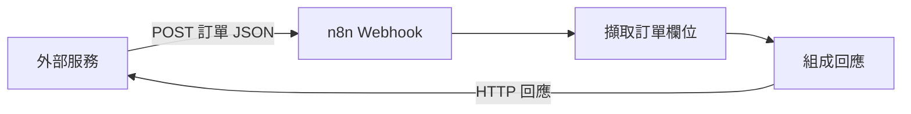

# Webhook、測試與回應

## 核心概念

外部系統向 n8n 的 Webhook URL 發送請求，可觸發工作流程。流程可以處理 JSON，並依 Webhook 回應設定把結果交還呼叫端。

- **Test URL** 用於編輯器的測試監聽。示範時先啟動監聽，再傳送請求。
- **Production URL** 用於已發佈的流程。可透過 Executions 檢查正式執行結果。
- 教學排查可依序查看 HTTP 方法、URL、監聽或發佈狀態，以及 JSON 是否符合預期。測試環境使用虛構訂單資料。

## 投影片與示範

先以 `{"orderId":"DEMO-001","amount":350}` 示意傳入內容，讓學員比對輸出中的 request body。下一頁把 [HTTP Request](api-http.md) 與 Webhook 放在同一張方向圖，分別標出誰發起請求。此案例為示範設計，尚未實測。

來源：[雷蒙入門指南](../sources/raymond-n8n-beginner.md)、[API 案例](../sources/ohya-api-http.md)、[n8n 官方文件](../sources/n8n-webhook.md)。
